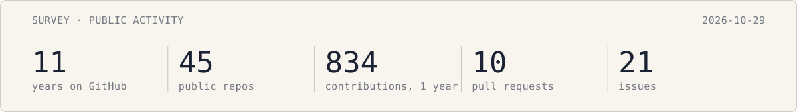
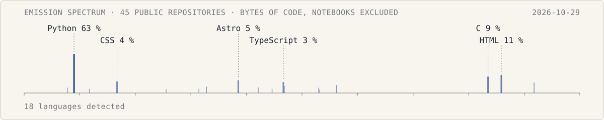

# Hi, I'm Vincent 👋

🔭 PhD candidate in astrophysics in Nice &nbsp;·&nbsp; 🛠️ maker of many small projects &nbsp;·&nbsp; 🤝 treasurer of two
associations, [AJC06](https://ajc06.com) and [Altearn](https://altearn.xyz)

I started with a computer science degree, and Minecraft turned me into a physicist: building a projectile system with
point physics and trigonometry is what made me switch to physics. Since then I keep jumping from one curiosity to the
next (piano, Japanese, 3D printing…), and most of them end up as a repository here. I like things that are simple,
elegant to use, and automated so that nobody has to do them twice.

  
🌍 [vincent.foriel.pro](https://vincent.foriel.pro) &nbsp;·&nbsp; 💼 [LinkedIn](https://fr.linkedin.com/in/vincentforiel)
&nbsp;·&nbsp; 🆔 [ORCID](https://orcid.org/0009-0009-3977-5499) &nbsp;·&nbsp; 🐍 [PyPI](https://pypi.org/user/Leirof/)
&nbsp;·&nbsp; ✉️ [vincent.foriel@gmail.com](mailto:vincent.foriel@gmail.com)

## 🔭 Research

At the Lagrange laboratory (Observatoire de la Côte d'Azur), I work on **tunable kernel-nulling**: photonic chips that
combine the light of several telescopes so that a star cancels itself out, and the faint planet next to it shows up.
I once explained it [in 180 seconds](https://youtu.be/wZDASBM8bMo).

- 🧮 [**PHISE**](https://github.com/VForiel/PHISE) simulates these instruments from the sky to the detector
  ([docs](https://phise.readthedocs.io/))
- 🔧 [**PHOBos**](https://github.com/VForiel/PHOBos) drives the laboratory bench: deformable mirror, camera, photonic
  chip ([docs](https://phob.readthedocs.io/))
- 📄 [**N4x4_T8-characterization**](https://github.com/VForiel/N4x4_T8-characterization): code and data of the paper
  on the calibration of an active photonic nulling interferometer
- 📚 [**PhD-Theory**](https://github.com/VForiel/PhD-Theory): the analyses of the thesis, with their notebooks

## 🛠️ Things I make

- 💡 [**LUMOS**](https://github.com/VForiel/LUMOS): an optical simulator that also drives real equipment, and talks to
  AI assistants ([try it](https://lumos.vincent.foriel.pro/))
- 🧰 [**LRFutils**](https://github.com/VForiel/LRFutils): my everyday scientific helpers, dated archives and editable
  figures ([PyPI](https://pypi.org/project/LRFutils/))
- 🌴 [**Nice-Event**](https://github.com/VForiel/Nice-Event): a participatory events calendar of Nice and its region
  ([nice-event.fr](https://nice-event.fr))
- 🐦 [**Material-Thunderbird**](https://github.com/VForiel/Material-Thunderbird): a Material theme for Thunderbird
- 🥰 [**Physister**](https://github.com/VForiel/Physister): physics explained to my little sister
- 🌐 and websites: [my own](https://vincent.foriel.pro), [AJC06's](https://github.com/VForiel/AJC06-Website), and a few
  for friends

## 🤝 Associations

- 🎓 **[AJC06](https://ajc06.com)**, the young researchers of the Alpes-Maritimes: evenings, seminars and help for PhD
  students of Université Côte d'Azur. I am the treasurer, and I built the website.
- 🧠 **[Altearn](https://altearn.xyz)**, "learn, differently": popular education with video games and the internet,
  through the [Gunivers](https://gunivers.net) Minecraft community and the Curiosity Discord. Treasurer too. My
  projectile system grew there into [Bookshelf](https://github.com/mcbookshelf/bookshelf), a Minecraft library of maths
  and physics tools.

## 📊 Observations

<picture>
  <source media="(prefers-color-scheme: dark)" srcset="assets/activity-dark.svg">
  
</picture>

<picture>
  <source media="(prefers-color-scheme: dark)" srcset="assets/spectrum-dark.svg">
  
</picture>

Measured every week by a workflow of this repository, no third-party service.
